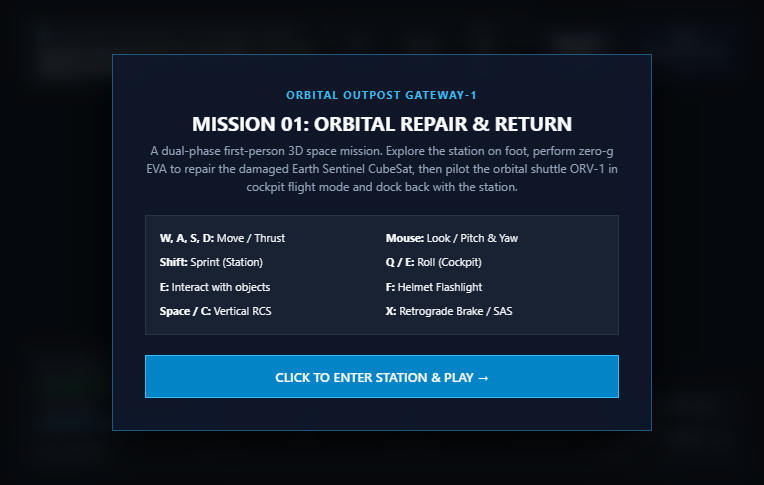

<div align="center">

# Space Mission Design Game

**High-Fidelity Aerospace Systems Engineering & Interactive 3D Orbit Operations Simulator**

Developed for the **NASA Space Apps Challenge 2026**

[](https://space-mission-design-game-i023rdwwh.vercel.app)
[](https://nextjs.org)
[](https://www.typescriptlang.org)
[](https://threejs.org)
[](https://bun.sh)
[](./LICENSE)

<br />



</div>

> **Live Production Simulator**: [https://space-mission-design-game-i023rdwwh.vercel.app](https://space-mission-design-game-i023rdwwh.vercel.app)

---

## Overview

**Space Mission Design Game** is an authentic, browser-native aerospace systems engineering and orbital operations simulator. Built with first-principles physics and zero-latency WebGL graphics, the platform features a connected **three-game campaign trilogy**, an interactive **3D celestial viewport**, and an engineering evaluation suite based on **NASA JPL Concept Maturity Level (CML 4)** and **Cal Poly CubeSat Design Specification (CDS Rev 14.1)** standards.

Every mission requirement, telemetry link budget, orbital burn, and spacecraft subsystem directly and deterministically impacts flight outcomes.

---

## The Three-Act Interactive Campaign Trilogy

The simulator features three distinct, interconnected 3D simulation games forming a continuous narrative:

```
[ Act I: Operation Artemis-VII ] ──(Radar Alert)──> [ Act II: Project Aegis ] ──(Spectrometry)──> [ Act III: Project Europa ]
 Gateway Spacewalk & Moon Base                       Mars Slingshot & DART Impact                   Cryo-Drill & Alien RNA
```

### Game 01: Operation Artemis-VII (Orbital Station & Lunar Base Alpha)
* **Narrative**: An intense Class X-4 Coronal Mass Ejection knocks out communications at the Gateway-1 orbital outpost. The player must suit up, conduct an extravehicular spacewalk (EVA) along the exterior gantry, repair the damaged AERO-3X Earth observation satellite, board the ORV-1 shuttle, execute a 6-DOF orbital descent, and touch down on Shackleton Lunar Base Alpha.
* **Core Gameplay Loop**:
  1. Review the Flight Directive at the Command Deck holographic table.
  2. Procure the 3 EVA tools (Aerospace Toolkit, GaAs Solar Wing, S-Band Transceiver) or use 1-click auto-equip.
  3. Cycle the airlock to vacuum and commence zero-gravity spacewalk.
  4. Perform the 4-step satellite repair (detach broken wing, mount solar array, install antenna, execute diagnostics).
  5. Board the ORV-1 shuttle and fly 6-DOF RCS rendezvous vectors.
  6. Execute powered lunar descent into Shackleton Crater and land on PAD-01.
  7. Deploy the Apollo ALSEP science station and extract cryogenic water-ice core samples.
* **Physics & Governing Equations**:
  * Microgravity translational inertia: $\vec{v}(t + \Delta t) = \vec{v}(t) + \frac{\vec{F}_{\text{RCS}}}{m} \Delta t$
  * Soft docking capture window: Relative velocity $\le 2.5\text{ m/s}$, angular alignment $\le 25^\circ$, distance $\le 2.2\text{ m}$.

### Game 02: Project Aegis (DART-II Planetary Defense)
* **Narrative**: Long-range radar on Lunar Base Alpha discovers an uncatalogued hazardous asteroid (65803 Didymos / Dimorphos) on a direct collision course with Earth. NASA launches interceptor Aegis-IV on a high-speed Mars gravity assist to deflect the threat via hypervelocity kinetic impact.
* **Core Gameplay Loop**:
  1. **Act I (Mars Oberth Slingshot)**: Ignite retrograde burn at 180 km periapsis altitude to achieve an $11.4\text{ km/s}$ hyperbolic egress velocity.
  2. **Act II (SMART Nav Autonomous Guidance)**: Overcome a 14-minute lightspeed communication delay by locking autonomous optical proportional navigation onto the target asteroid.
  3. **Act III (Terminal 6.2 km/s Run)**: Steer cold-gas RCS micro-thrusters to align within the 3-meter Circular Error Probable (CEP) bullseye at $6.2\text{ km/s}$ closing velocity.
  4. **Act IV (LICIACube Damage Assessment)**: Observe the impact plume from companion CubeSat LICIACube and calculate orbital period deflection ($\Delta T \ge 73\text{ seconds}$, $\beta = 3.6$ momentum enhancement).
* **Physics & Governing Equations**:
  * Oberth effect amplification: $v_{\text{hyp}}^2 = v_{\text{burn}}^2 + \frac{2 \mu_{\text{mars}}}{r_{\text{periapsis}}}$
  * Proportional navigation guidance: $\vec{a}_{\text{cmd}} = N v_{\text{closing}} \vec{\omega}_{\text{LOS}}$ ($N = 3.5$)
  * Orbital period shift: $\Delta T = -\frac{3 \pi a^{3/2}}{\sqrt{\mu_{\text{primary}}}} \cdot \frac{\Delta v_{\text{along-track}}}{v_{\text{orbit}}}$

### Game 03: Project Europa (Subterranean Ocean & Alien RNA)
* **Narrative**: LICIACube ejecta spectrometry detects complex prebiotic amino acids originating from Jupiter's icy moon Europa. Expedition Deep-Valkyrie is dispatched to penetrate the ice shell and discover whether extraterrestrial life thrives in the hydrothermal ocean abyss.
* **Core Gameplay Loop**:
  1. **Act I (Jovian Radiation Evasion & Chaos Landing)**: Align lead-Kevlar shielding along magnetic flux lines to survive $400\text{ rad/hr}$ radiation, then touch down on smooth chaos terrain.
  2. **Act II (Nuclear Cryo-Drill Melt)**: Engage the 250 kW thermal probe at $900^\circ\text{C}$ to melt through $20\text{ km}$ of cryogenic ice, evading pressurized methane pockets.
  3. **Act III (Abyssal Submersible Navigation)**: Pilot a 6-DOF submarine through pitch-black saltwater under $130\text{ MPa}$ hydrostatic pressure, using active sonar pings to track hydrothermal plumes.
  4. **Act IV (Robotic Sample Extraction & RNA Confirmation)**: Deploy the robotic manipulator arm to extract biofilm from a hydrothermal black smoker chimney. Mass spectrometry confirms extraterrestrial ribosomal RNA.
* **Physics & Governing Equations**:
  * Thermal ice penetration rate: $\dot{z} = \frac{\eta_{\text{thermal}} P_{\text{reactor}}}{\rho_{\text{ice}} A_{\text{probe}} [c_p (T_m - T_0) + L_f]}$ ($\approx 80\text{ m/hr}$)
  * Hydrostatic ocean pressure: $P(z) = P_{\text{surface}} + \rho_{\text{brine}} g_{\text{europa}} z$ ($g_{\text{europa}} = 1.315\text{ m/s}^2$)
  * Biogenic RNA confirmation: Shannon informational entropy $> 1.8\text{ bits/monomer}$, $\delta^{13}\text{C} = -34.5‰$.

---

## 3D Celestial Viewport Modes

The main menu features a multi-mode real-time Three.js celestial background switcher:

| Viewport Mode | Visual Architecture | Scientific & Visual Elements |
| :--- | :--- | :--- |
| **Solar System Orrery** | 3D Helical Planetary Model | All 8 planets rendered with relative distances, Keplerian orbital velocities, Asteroid Belt particle cloud, and click-to-inspect NASA JPL telemetry cards. |
| **Earth Blue Marble** | Procedural Canvas Shader | High-resolution continental geometry, oceanic specularity, dynamic cloud layers, day/night terminators, and atmospheric Rayleigh scattering. |
| **Gargantua Black Hole** | Relativistic Three.js Vista | Authentic Interstellar-style curved golden gravitational lensing arches, pitch-black event horizon ($R = 2.0$), white photon sphere ($R = 2.14$), and 1,400 swirling Keplerian dust particles. |

---

## Flight Controls & Frictionless Interaction

The simulator implements a zero-pixel-hunting interaction model inspired by responsive web game architectures (e.g., Deadshot.io). All mission actions can be executed via either keyboard hotkeys or high-contrast 1-click HUD action pills.

### Universal Control Table

| Action Domain | Keyboard Key | Mouse / Touch Fallback | Description |
| :--- | :--- | :--- | :--- |
| **Astronaut Movement** | `W / A / S / D` | Virtual Joystick | Walk, strafe, and move in pressurized or EVA environments. |
| **Primary Interaction** | `E` | Left Click | Review directives, equip tools, cycle airlocks, repair satellites, and sample RNA. |
| **1-Click Assist Pill** | `E` or Click | Screen Action Button | Deterministically executes the active step without requiring target centering. |
| **Spacecraft Flight (6-DOF)** | `W / S`, `A / D`, `Q / E` | On-Screen Thrusters | Main thrust, yaw, roll, and vertical translation. |
| **Lunar Descent Sector Jump** | `T` | `[T] DESCENT TO MOON` | Initiates emergency powered descent trajectory from orbit to Lunar Base Alpha. |
| **Disembark Spacecraft** | `H` | `[H] DISEMBARK` | Exits the ORV-1 cockpit onto the Shackleton landing pad. |
| **Quick Inventory Select** | `1`, `2`, `3`, `4` | Inventory Quickbar | Equips Toolkit [1], Solar Wing [2], S-Band Antenna [3], or ALSEP Kit [4]. |
| **Burn / Drill / Sonar** | `SPACE` | Action Button | Ignites Oberth burn, throttles cryo-drill, or pings active sonar. |
| **Pause / Return to Hub** | `ESC` / `P` | `[ESC] PAUSE` / Hub | Pauses physics simulation and opens menu navigation. |

---

## Subsystem Engineering Calculators (Flight Academy)

In addition to first-person gameplay, the Flight Academy provides first-principles engineering calculators adhering to NASA standards:

| Engineering Domain | Governing Equations | Agency Specification | Compliance Criteria |
| :--- | :--- | :--- | :--- |
| **Mass Budget (MEL)** | $m_{\text{total}} = \sum m_i \cdot (1 + \text{MGA}_i)$ | Cal Poly CDS Rev 14.1 §2.2.10 | $1\text{U} \le 2.00\text{ kg}$, $3\text{U} \le 6.00\text{ kg}$, $6\text{U} \le 12.00\text{ kg}$; Dry mass margin $\ge 35\%$. |
| **Power Balance (EPS)** | $P_{\text{gen}} = S_0 \cdot \eta_{\text{cell}} \cdot A \cdot \cos(\theta)$ | NASA SP-2016-6105 §4.3.2 | Solar constant $S_0 = 1361\text{ W/m}^2$; Battery DoD $\le 25\%$ nominal, $\le 70\%$ eclipse floor. |
| **Telecom Link Budget** | $P_{\text{rx}} = P_{\text{tx}} + G_{\text{tx}} + G_{\text{rx}} - \text{FSPL} - L_{\text{misc}}$ | NASA LSP-REQ-317.01 §2.4.5 | Link margin $\ge +3.0\text{ dB}$; 45-minute post-deployment RF silence strictly enforced. |
| **Thermal Equilibrium** | $Q_{\text{in}} = Q_{\text{solar}} + Q_{\text{albedo}} + Q_{\text{IR}} = \epsilon \sigma A T^4$ | Stefan-Boltzmann Radiation | Equilibrium bus temperature maintained strictly between $-20^\circ\text{C}$ and $+50^\circ\text{C}$. |

---

## Technology Stack

```
Frontend Architecture      Next.js 16 (App Router, Turbopack)
Language                   TypeScript 5.9 (Strict Type Checking)
Runtime & Package Manager  Bun 1.3
3D Graphics & WebGL        Three.js 0.187 + React Three Fiber 9.8 / Drei 10.7
Audio Synthesis            Web Audio API (Procedural Telemetry & Acoustic Synth Engine)
Design System              Aerospace Design Tokens (tokens.css, globals.css)
Testing Framework          Bun Test (367 Unit & Systems Tests across 17 Suites)
Deployment Platform        Vercel Cloud Platform
```

---

## Getting Started

### Prerequisites
* [Bun](https://bun.sh/) (v1.2+) or Node.js (v20+)

### Quick Start
```bash
# 1. Clone repository
git clone https://github.com/divyansBaserra/Space-Mission-Design-Game.git
cd Space-Mission-Design-Game

# 2. Install dependencies
bun install

# 3. Start local development server
bun run dev

# 4. Open in browser
# http://localhost:3000
```

### Verification & Testing
```bash
# Run full automated test suite (367 passed tests, 13,811 assertions)
bun test

# Run strict TypeScript type verification
bun run type-check

# Compile optimized production build
bun run build
```

---

## Aerospace Standards & Verification

All equations, mass margins, RF link budgets, and operational timers within this codebase are verified against official agency specifications:

* **NASA Systems Engineering Handbook**: `NASA SP-2016-6105 Rev 2`
* **Cal Poly CubeSat Design Specification**: `CDS Rev 13 & Rev 14.1`
* **NASA Launch Services Program**: `LSP-REQ-317.01 Rev B`
* **NASA JPL Team X Methodology**: `JPL CML Levels 1–7`
* **NASA Planetary Defense Coordination**: `DART Mission Astrodynamics Standards`
* **NASA Ocean Worlds Life Surveyor (OWLS)**: `Astrobiology Biogenic Metrics`

---

## Asset Credits & Attributions

All geometries, procedural textures, and planetary resources are utilized under permissive open-source licenses:
* **3D Modular Outpost Assets**: Kenney Space & Space Station Kits (CC0 1.0 Universal / Public Domain).
* **Planetary Geometries & Textures**: NASA Scientific Visualization Studio & Visible Earth (NASA Public Domain).
* Complete licensing documentation is available in [ASSET_CREDITS.md](./ASSET_CREDITS.md).

---

<div align="center">
  <sub>Developed for the <strong>NASA Space Apps Challenge 2026</strong>. Built with precision and first-principles aerospace engineering.</sub>
</div>
